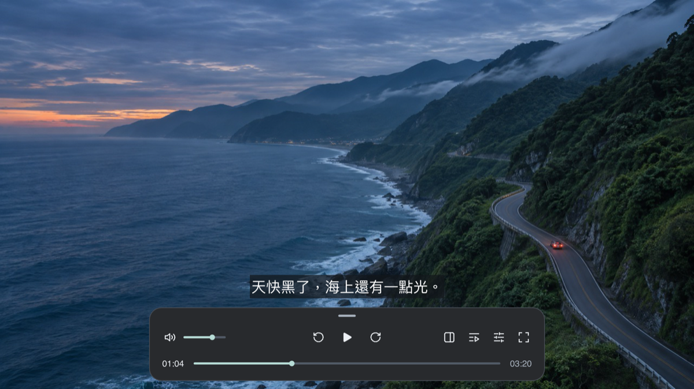

# Floating mpv controls for Stremio

English · [繁體中文](README.zh-TW.md)

A Lua script that adds a floating control bar and a subtitle and audio sidebar to the external mpv player opened by Stremio.



Drag the handle to move the controls. The bar hides when the mouse is idle during playback. Open the track sidebar with **F9** or the sidebar button, and close it with **Esc**. Use the playlist button to browse playback items and the settings button to change playback speed or pin the controls. [See the track sidebar](preview-track-sidebar-en.png)

## Install

1. Download both project files. [Lua script](modern-osc.lua) · [Configuration](modern-osc.conf)
2. Put the script in `scripts/` and the configuration in `script-opts/` inside your mpv configuration directory.

   | Platform | Configuration directory |
   | --- | --- |
   | macOS | `~/.config/mpv` |
   | Windows | `%APPDATA%\mpv`, or `portable_config` next to `mpv.exe` for a portable install |

3. Fully exit mpv. Open a video in Stremio and choose mpv as the external player.

On Windows, the player shows a close button at the upper-right of the video when window decorations are hidden. In fullscreen, move the pointer to that corner to reveal it.

Track availability depends on the stream and subtitle files that mpv receives. If uosc is installed, its menus remain available alongside the floating controls.

Autoload, track switching, playback controls, and dragging have been tested with local media on macOS. Stremio streaming and Windows hardware testing are pending.

## Interface language

Set `language` in `script-opts/modern-osc.conf` and restart mpv.

| Setting | Language |
| --- | --- |
| `auto` | System language |
| `en` | English |
| `zh-TW` | 繁體中文 |
| `zh-CN` | 简体中文 |
| `ja` | 日本語 |
| `es` | Español |

In `auto` mode the script looks for a supported desktop language on Windows and macOS, then uses the locale environment and falls back to English. Regional variants such as `en-GB` and `es-MX` use the matching language.

To contribute a translation, add a language code to the `translations` table and use the English entries as a template. Preserve placeholders such as `%d` for track numbers. [Translation strings](modern-osc.lua)

## Customize the layout

Edit `script-opts/modern-osc.conf` and restart mpv.

| Setting | Options |
| --- | --- |
| `controls_layout` | `floating` for the draggable bar or `bottom` for a bar along the bottom edge |
| `controls_left`, `controls_center`, `controls_right` | Comma-separated button order for each area |
| `button_size`, `button_spacing` | Button size and spacing |
| `sidebar_open` | `yes` to open the track sidebar at startup |
| `sidebar_side` | `left` or `right` |
| `sidebar_mode` | `docked` to resize the video or `overlay` to draw over it |
| `sidebar_layout` | `stacked` to show both track groups or `tabs` to switch between them |
| `sidebar_order` | `sub,audio`, `audio,sub`, or one group |
| `font`, `font_scale` | Font and text size. Leave `font` empty to use mpv's OSD font. |
| `radius`, `panel_opacity`, `sidebar_opacity` | Corner radius in pixels and opacity from 0 to 1 |
| `subtitle_backdrop` | Dark background for plain text subtitles. Use `no` to keep your mpv settings. |
| `dark_title_bar` | Dark native title bar on macOS. Use `no` to keep your mpv settings. |
| `color_*` | Six-digit RGB colors |

You can place `volume`, `back`, `play`, `forward`, `tracks`, `playlist`, `settings`, `pin`, and `fullscreen` in any area, or leave an area empty. Narrow windows wrap buttons into rows and use an overlay sidebar.

This example uses a left-side tabbed sidebar and a lavender accent.

```ini
language=en
sidebar_side=left
sidebar_layout=tabs
controls_left=tracks,pin
controls_center=back,play,forward
controls_right=volume,fullscreen
color_selected=493A59
color_accent=D8C5F0
```
