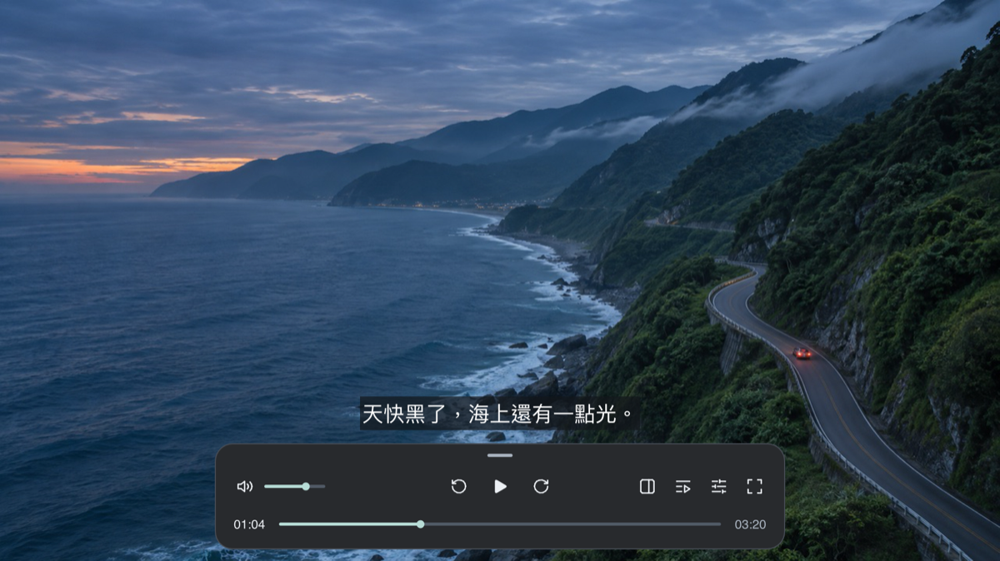

# Stremio 外部 mpv 介面

[English](README.md) · 繁體中文

這個 Lua 腳本會載入 Stremio 呼叫的 mpv 視窗。預設的 540px 懸浮控制列採用深色圓角、線條圖示與薄荷綠滑桿。播放時滑鼠閒置會自動收起控制列，拖曳頂端短線可重新定位。



側欄預設收合。按 `F9` 或點控制列上的側欄圖示即可選擇字幕和音軌，按 `Esc` 收合。播放清單圖示列出這個 mpv 視窗的播放項目。播放設定可調整速度並固定控制列。滑鼠移到圖示上會顯示按鍵名稱。

[查看字幕與音軌側欄](preview-track-sidebar.png)

程式會與已安裝的 uosc 協調介面元素，uosc 的選單功能可以繼續使用。

## 安裝

安裝需要以下兩個檔案。[Lua 腳本](modern-osc.lua) · [介面設定檔](modern-osc.conf)

macOS 將 `modern-osc.lua` 放入 `~/.config/mpv/scripts/`，`modern-osc.conf` 放入 `~/.config/mpv/script-opts/`。

Windows 將兩個檔案分別放入 mpv 設定目錄的 `scripts` 與 `script-opts` 子目錄。常見的設定目錄為 `%APPDATA%/mpv`，portable_config 安裝則使用該目錄。

在 Windows 的無邊框或隱藏標題列視窗中，影片區右上角的 `×` 可以關閉 mpv。全螢幕播放時，把滑鼠移到影片區右上角就會顯示這個按鈕。

從 Stremio 選擇外部 mpv 後開啟串流，介面會跟著載入。可選取的字幕與音軌由傳入 mpv 的串流和外掛字幕決定。

已在 macOS 用本機影片驗證自動載入、切換字幕與音軌、播放控制和拖曳。Stremio 實際串流與 Windows 待驗證。

## 介面語言

在 `script-opts/modern-osc.conf` 設定 `language`。預設 `auto` 會依照系統的介面語言選擇，接著查找執行環境的語言設定，最後以英文作為預設。完整退出 mpv 後重新開啟即可套用。

| 設定值 | 介面語言 |
| --- | --- |
| `auto` | 自動選擇 |
| `zh-TW` | 繁體中文 |
| `zh-CN` | 简体中文 |
| `en` | English |
| `ja` | 日本語 |
| `es` | Español |

## 自訂主題與布局

編輯 `script-opts/modern-osc.conf`，完整退出 mpv 後重新從 Stremio 開啟影片，即可套用設定。

| 設定 | 可用值與用途 |
| --- | --- |
| `controls_layout` | `floating` 可拖曳懸浮，`bottom` 貼底顯示 |
| `controls_left` | 控制列左區的按鍵，由左至右排列 |
| `controls_center` | 控制列中區的按鍵，由左至右排列 |
| `controls_right` | 控制列右區的按鍵，由左至右排列 |
| `button_size`、`button_spacing` | 按鍵大小與間距 |
| `sidebar_open` | 設成 `yes` 會在啟動時展開字幕與音軌側欄 |
| `sidebar_side` | `left` 或 `right` |
| `sidebar_mode` | `docked` 縮排影片，`overlay` 覆蓋影片 |
| `sidebar_layout` | `stacked` 同時列出兩組軌道，`tabs` 以分頁切換 |
| `sidebar_order` | `sub,audio` 或 `audio,sub`，可只保留一組 |
| `font`、`font_scale` | 字型與字體縮放，字型留空時沿用 mpv 設定 |
| `radius` | 懸浮面板圓角，`0` 為直角 |
| `panel_opacity`、`sidebar_opacity` | 背景不透明度，範圍為 `0` 到 `1` |
| `subtitle_backdrop` | 純文字字幕的半透明背景，設成 `no` 沿用 mpv 設定 |
| `dark_title_bar` | macOS 原生深色標題列，設成 `no` 沿用 mpv 設定 |
| `color_*` | 面板、邊框、滑桿等介面色彩，採六位 RGB 色碼 |

按鍵項目包括 `volume`、`back`、`play`、`forward`、`tracks`、`playlist`、`settings`、`pin`、`fullscreen`。以逗號分隔，可移動到任何一區，也可刪除或留空。重複項目會採用第一次出現的位置。控制列寬度不足時，按鍵會依區域分行。

左側分頁與淡紫色選取效果可用以下設定套用。

```ini
sidebar_side=left
sidebar_layout=tabs
sidebar_order=sub,audio
controls_left=tracks,pin
controls_center=back,play,forward
controls_right=volume,fullscreen
color_selected=493A59
color_accent=D8C5F0
```

貼底控制列的例子可以使用下面設定。

```ini
controls_layout=bottom
controls_left=play,back,forward
controls_center=
controls_right=volume,tracks,fullscreen
radius=0
```

窄視窗會採用覆蓋式側欄，並在選軌時收起懸浮控制列。收合側欄後可繼續使用控制列。視窗高度較低時，兩組軌道會以分頁顯示。

變更按鍵、側欄位置與色彩後，Stremio 會繼續使用原本設定的外部 mpv 入口載入這份介面。
